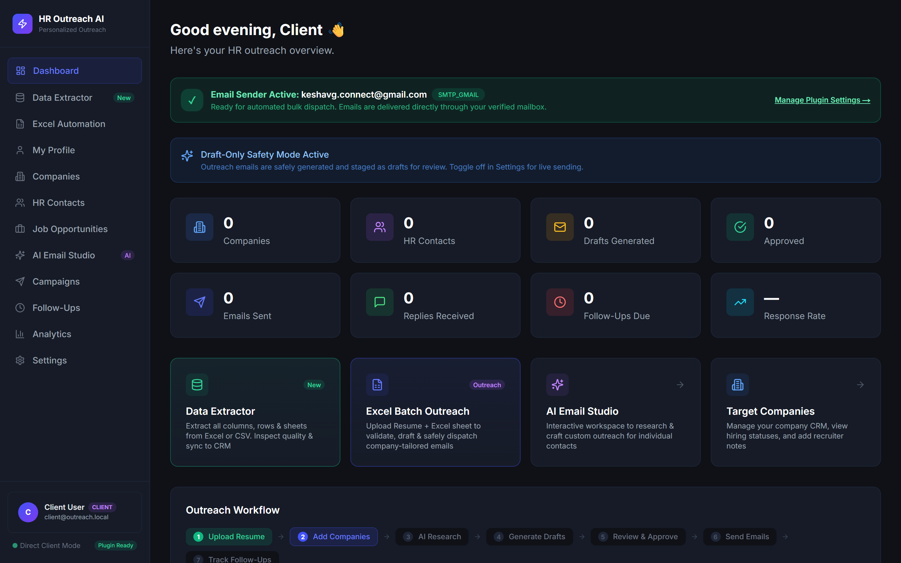
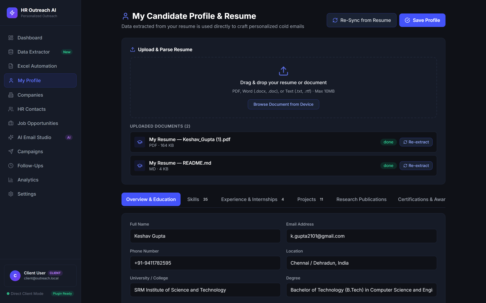
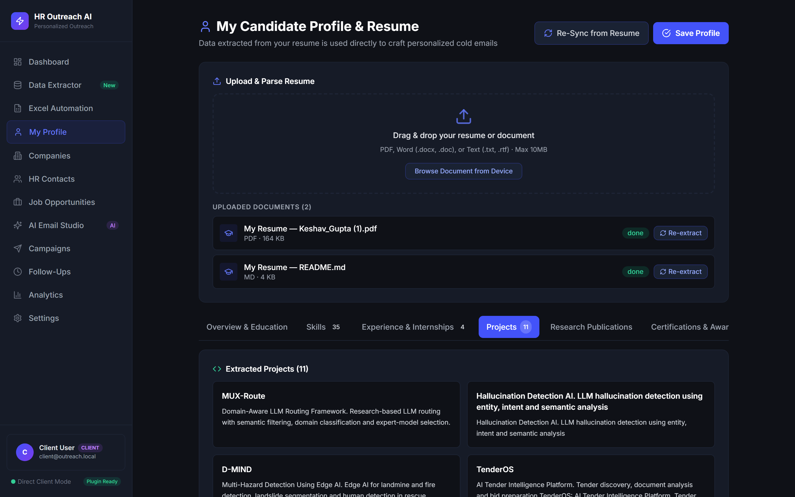
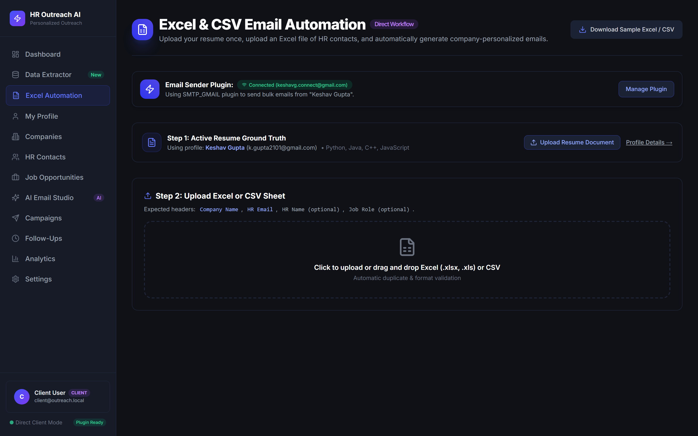
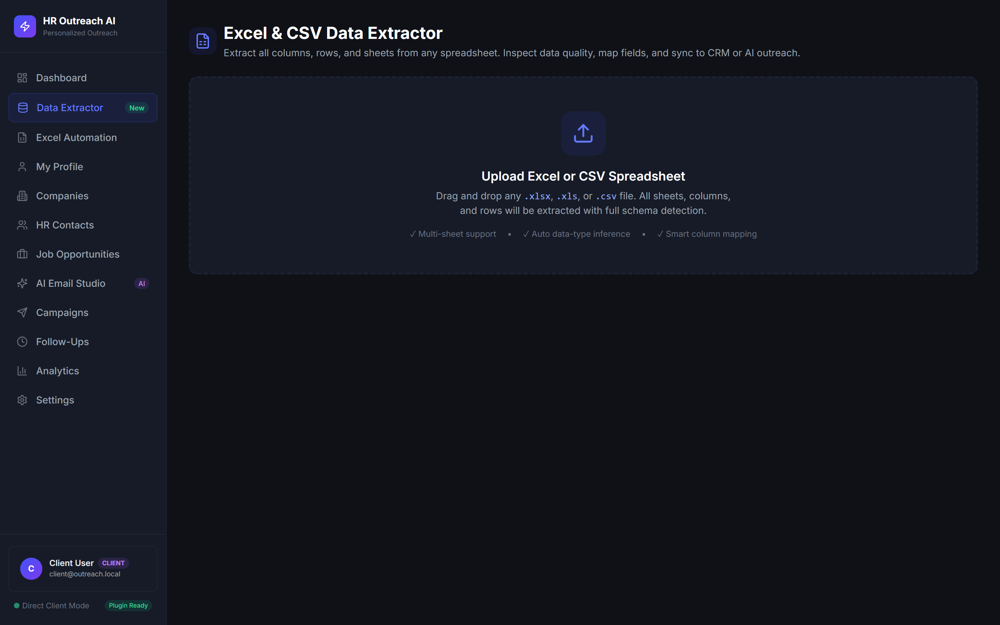
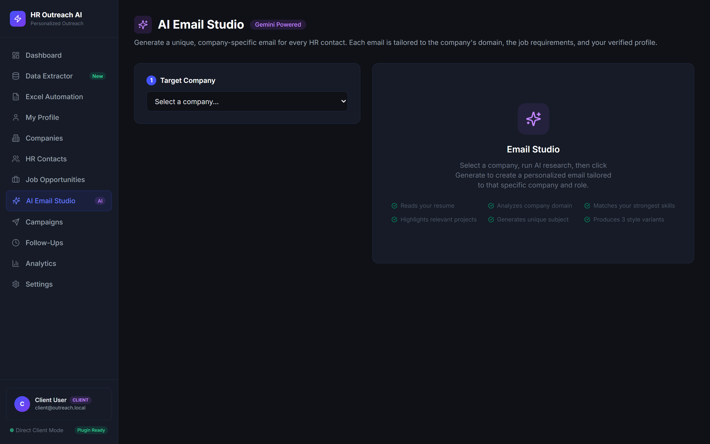
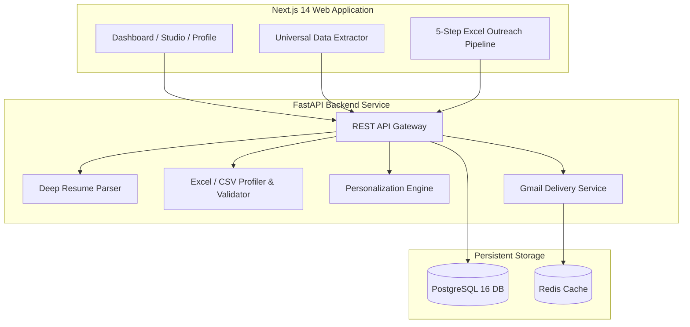

# 🚀 HR Outreach & AI Cold Email Automation Platform

<div align="center">

[](https://vercel.com/new/clone?repository-url=https%3A%2F%2Fgithub.com%2Fkeshav2101%2Femail-automation&root-directory=frontend)
[](https://nextjs.org/)
[](https://fastapi.tiangolo.com/)
[](https://www.postgresql.org/)
[](https://redis.io/)
[](https://www.docker.com/)
[](LICENSE)

<p align="center">
  <b>Production-ready cold email outreach platform unifying deep resume intelligence, universal Excel/CSV data extraction, and AI-driven 150-word outreach.</b>
  <br />
  <a href="#-real-application-showcase">📸 Real Screenshots</a> •
  <a href="#-deploy-to-vercel-in-30-seconds">🌐 Deploy to Vercel</a> •
  <a href="#-key-features">🌟 Features</a> •
  <a href="#-quick-start-local-development">⚡ Quick Start</a> •
  <a href="#-architecture">🏗️ Architecture</a>
</p>

</div>

---

## 📸 Real Application Showcase

*Captured directly from the running production interface (`http://localhost:3000`).*

### 1. Unified Dashboard & Live Sender Status
> *Live overview showing system statistics, active candidate intelligence summary, quick actions, and verified Gmail connection status.*

<div align="center">
  
</div>

---

### 2. Candidate Profile & Deep Resume Parser
> *Automatic extraction of candidate profile details (SRMIST, B.Tech CSE, GPA, Contact Info, LinkedIn, GitHub, and Scopus Author ID profile) with 1-click Re-Sync.*

<div align="center">
  
</div>

---

### 3. Extracted Projects & Research Publications
> *Comprehensive extraction showing 11 distinct software and AI/ML projects alongside peer-reviewed research publications with DOIs.*

<div align="center">
  
</div>

---

### 4. 5-Step Excel/CSV Cold Email Batch Pipeline
> *Streamlined workflow: Upload Spreadsheet ➔ Auto-map Columns ➔ Pre-validate Syntax & Duplicates ➔ Generate 100–150 Word Tailored Emails ➔ Dispatch with Rate Throttling.*

<div align="center">
  
</div>

---

### 5. Universal Excel & CSV Data Extractor
> *Zero-schema ingestion supporting `.xlsx`, `.xls`, and `.csv` files. Inferred column semantic types (`Email`, `URL`, `Phone`, `Number`), fill-rate health metrics, and 1-click sync to CRM.*

<div align="center">
  
</div>

---

### 6. AI Cold Email Studio & Live Preview
> *Generate tailored 100–150 word cold emails with tone selection, real-time live preview, and resume context injection.*

<div align="center">
  
</div>

---

## 🌟 Key Features

| Capability | Description |
|---|---|
| 📄 **Deep Resume Parser** | Structural section extraction for University, Degree, Grad Year, GPA, Work Experience, Internships, Projects, Publications (with DOIs), Skills, and Awards. |
| 📊 **Universal Excel Extractor** | Parses `.xlsx`, `.xls`, `.csv` with zero schema restrictions. Auto-detects emails, URLs, roles, and provides live quality health metrics. |
| ⚡ **5-Step Batch Outreach** | Upload sheet ➔ Auto-map columns ➔ Pre-validate duplicates & syntax ➔ Generate 100–150 word tailored emails ➔ Dispatch via Gmail. |
| ✉️ **Gmail SMTP & Handshake** | Uses 16-character Google App Password with immediate real-time SMTP handshake verification. |
| 🛡️ **Deliverability Controls** | Configurable inter-email throttle delays (5s, 10s, 30s), daily send quotas, and global suppression checking. |
| 🚀 **Direct Client Mode** | Instant access with zero auth wall or friction. |

---

## 🌐 Deploy to Vercel in 30 Seconds

Deploy the frontend directly to Vercel with zero configuration:

[](https://vercel.com/new/clone?repository-url=https%3A%2F%2Fgithub.com%2Fkeshav2101%2Femail-automation&root-directory=frontend)

### Step-by-Step Vercel Deployment
1. Click the **Deploy with Vercel** button above or visit [vercel.com/new](https://vercel.com/new).
2. Connect your GitHub account and select `keshav2101/email-automation`.
3. Set the **Root Directory** to `frontend`.
4. Add the Environment Variable:
   - `NEXT_PUBLIC_API_URL`: Your backend URL (e.g. `https://your-api.onrender.com/api/v1` or `http://localhost:8000/api/v1`)
5. Click **Deploy** — your live dashboard will be live at `https://<your-project>.vercel.app`!

---

## 🏗️ Architecture



---

## ⚡ Quick Start (Local Development)

### 🐳 Option A: Docker Compose (Recommended)
```bash
git clone https://github.com/keshav2101/email-automation.git
cd email-automation
docker compose up -d
```
Access endpoints:
- **Web Dashboard:** [http://localhost:3000](http://localhost:3000)
- **FastAPI Interactive Docs:** [http://localhost:8000/docs](http://localhost:8000/docs)
- **Postgres:** Port `5434`
- **Redis:** Port `6380`

---

### 💻 Option B: Windows 1-Click Launcher
Run the built-in batch script in Command Prompt or PowerShell:
```cmd
.\start.bat
```
Interactive menu:
- `[1]` Launch Web Platform (Frontend + Backend)
- `[3]` Launch Everything
- `[4]` Launch with Docker Compose
- `[5]` Run Pytest Test Suite

---

### 🛠️ Option C: Manual Setup

<details>
<summary><b>Click to expand manual setup instructions</b></summary>

#### Backend
```bash
cd backend
python -m venv .venv

# Windows
.\.venv\Scripts\activate
# Linux/macOS
source .venv/bin/activate

pip install -r requirements.txt
uvicorn app.main:app --port 8000 --reload
```

#### Frontend
```bash
cd frontend
npm install
npm run dev
```

</details>

---

## 🧪 Testing & Verification

Run the comprehensive backend integration test suite:

```bash
cd backend
.\.venv\Scripts\activate
pytest tests/ -v
```

```
============================= test session starts =============================
test_api.py::test_health_check PASSED                                    [ 14%]
test_api.py::test_auth_workflow PASSED                                   [ 28%]
test_api.py::test_candidate_profile_and_companies PASSED                 [ 42%]
test_api.py::test_batch_automation_endpoints PASSED                      [ 57%]
test_api.py::test_extractor_endpoints PASSED                             [ 71%]
test_api.py::test_email_plugin_and_bulk_automation PASSED                [ 85%]
test_api.py::test_document_upload_and_client_role PASSED                 [100%]
============================== 7 passed in 7.18s ==============================
```

---

## 📄 License
This project is open-source under the [MIT License](LICENSE).
